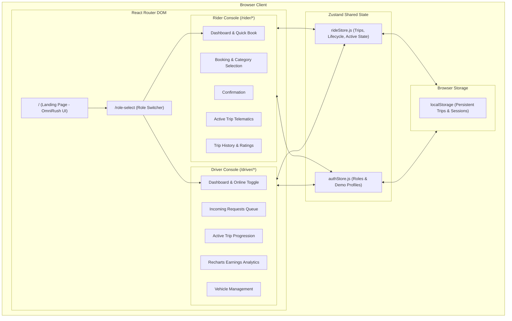
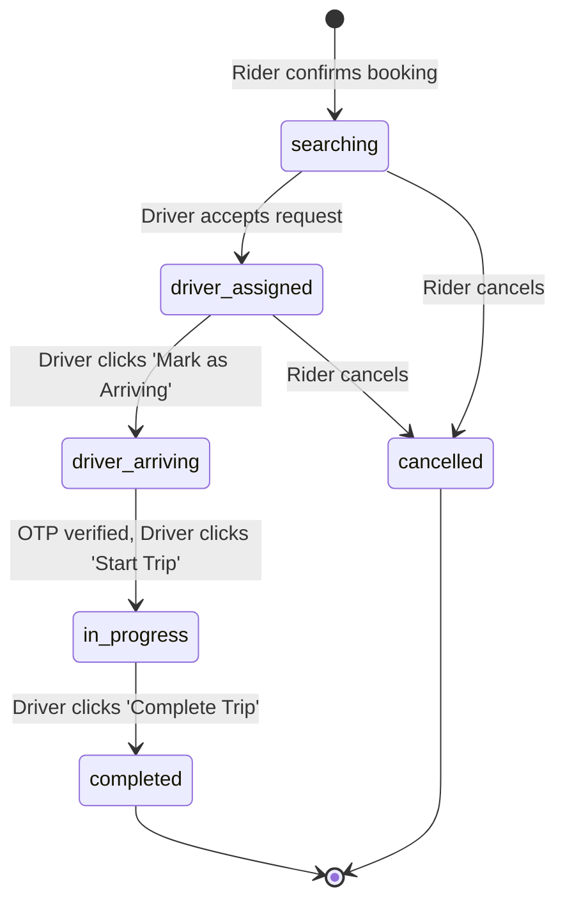

# Technical Architecture Document

## 1. System Overview

RideFlow is a client-side single page application (SPA) built with React 19 and Vite. The system simulates an entire ride-sharing platform with bidirectional state synchronization between riders and drivers without requiring a backend server or external database.



---

## 2. Directory Layout

```text
Ride/
├── docs/
│   ├── PRD.md             # Product Requirements Document
│   ├── RULES.md           # Engineering principles & guardrails
│   └── ARCHITECTURE.md    # Technical architecture & state synchronization
├── frontend/
│   ├── public/
│   │   └── buildathon/    # Branded assets (brush.svg, fonts, keys art)
│   ├── src/
│   │   ├── components/    # Reusable UI components (Navbar, Map, Cards, Modals)
│   │   ├── layouts/       # PublicLayout, RiderLayout, DriverLayout
│   │   ├── pages/
│   │   │   ├── public/    # LandingPage, RoleSelect, Login, Register, Help
│   │   │   ├── rider/     # Rider dashboard, booking, active tracking, history
│   │   │   └── driver/    # Driver dashboard, requests, trip management, earnings
│   │   ├── data/          # Mock locations, drivers, categories, pricing matrix
│   │   ├── store/         # Zustand stores (authStore.js, rideStore.js)
│   │   ├── utils/         # fareCalculator, routeSimulator, storage, formatters
│   │   ├── styles/        # omnirush-theme.css, index.css
│   │   ├── router.jsx     # Route definitions
│   │   └── main.jsx       # Entry point
│   ├── package.json
│   └── vite.config.js
└── README.md              # Project documentation & quick start
```

---

## 3. Core State Synchronization Flow

### Ride Lifecycle State Diagram



### Key Data Structures

#### Ride Object Schema
```javascript
{
  id: "ride-1730000000000",
  riderId: "rider-aryan-1",
  riderName: "Aryan Mehra",
  driverId: "driver-vikram-1",     // Nullable until assigned
  driver: { ... },                 // Driver snapshot
  pickup: { id, name, lat, lng },
  destination: { id, name, lat, lng },
  category: { id, name, baseFare, ... },
  distanceKm: 14.2,
  durationMins: 28,
  estimatedFare: 295,
  finalFare: 295,
  driverEarnings: 242,             // 82% commission
  paymentMethod: "UPI",
  status: "searching",             // searching | driver_assigned | driver_arriving | in_progress | completed | cancelled
  otp: "4829",
  createdAt: "2026-10-26T12:00:00.000Z",
  completedAt: null
}
```

---

## 4. UI Design System: Neo-Brutalist Omnirush Aesthetic

- **Design Philosophy:** Inspired by `omnirush.ai/buildathon`.
- **CSS Architecture:** Encapsulated inside `omnirush-theme.css` under the root container `.fb-page`.
- **Primary Color Tokens:**
  - Ink Background & Borders: `#0b0630`
  - Electric Indigo Blue: `#3a2df5`
  - Electric Acid Lime: `#d8fc38`
  - Soft Lavender Paper: `#e6e3ff`
- **Brutalist Shadows:** Offset solid drop shadows (`box-shadow: 4px 4px 0 #0b0630`).
- **Interactive Widgets:** Interactive Fare Estimator, dynamic Radar Dispatcher, infinite Marquee, and sticky bottom Action Bar.
